# Фруктовый дворец — витрина с заявкой в WhatsApp

Одностраничный сайт магазина «Фруктовый дворец» (Санкт-Петербург, Сытнинская ул., 12):
каталог из 25 позиций с поиском, рядами и сеткой, пакет с повтором заказа, конструктор
ящиков, сезонный календарь, галерея с лайтбоксом, пять тем оформления, подсказки прилавка.
Оплата не принимается — итог по позиции называет продавец в ответ на заявку.
Чистые HTML/CSS/JS без фреймворков и без сторонних библиотек; шрифты и фото собирает CI,
трекеров нет.

## Витрина на скриншотах

Снимки — не макеты и не генерация: это живые рендеры локальной сборки, снятые headless
Chromium (1440×900 и 390×844) и переснятые перед этим релизом.

| Первый экран | Ряды прилавка | Грифельная доска |
|---|---|---|
| 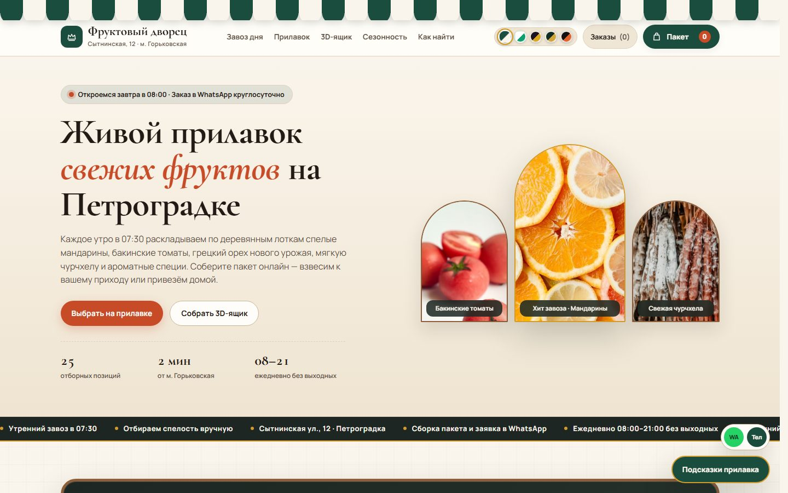 | 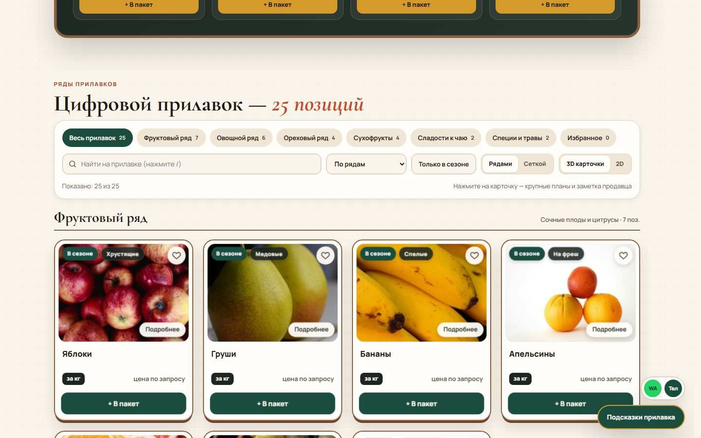 | 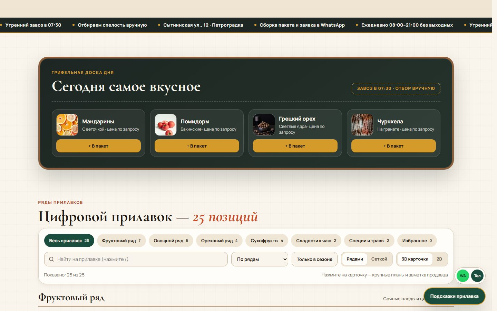 |

| Конструктор ящика | Галерея | Вопросы |
|---|---|---|
| 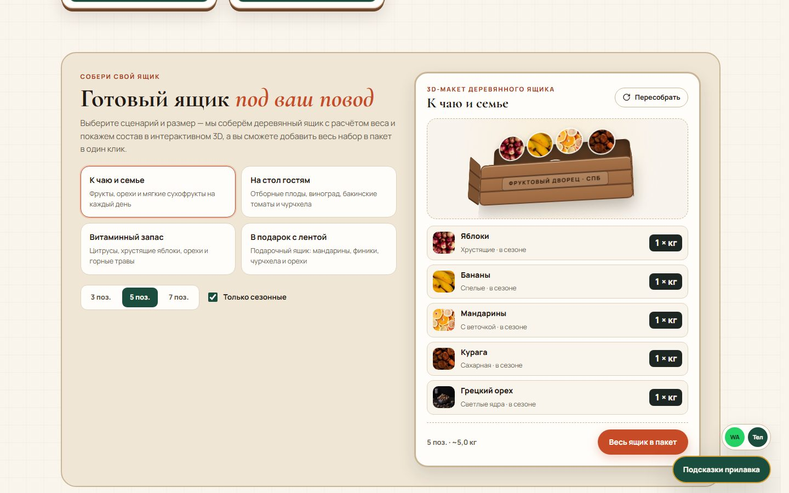 | 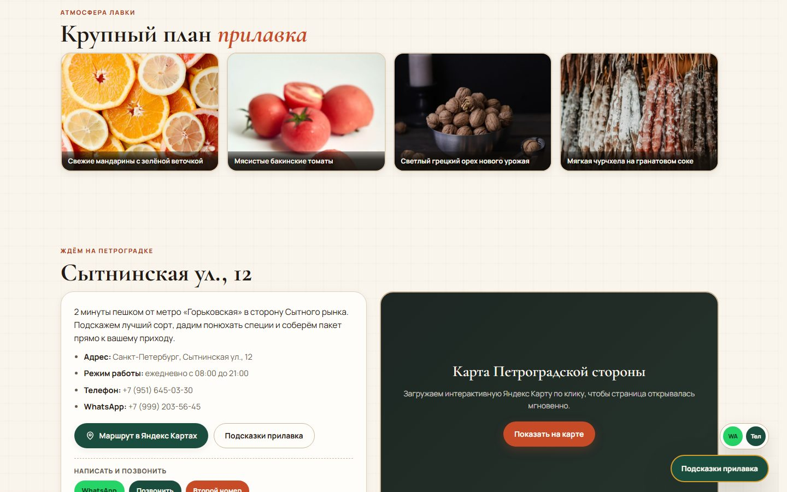 | 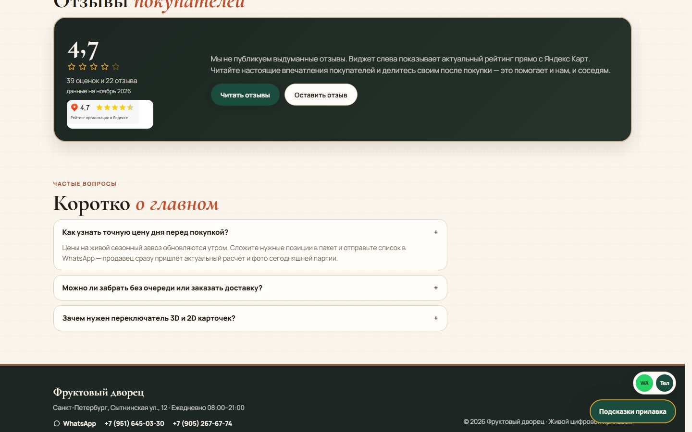 |

| Пакет | Заявка | Подсказки прилавка | Подглядывание в карточке |
|---|---|---|---|
| 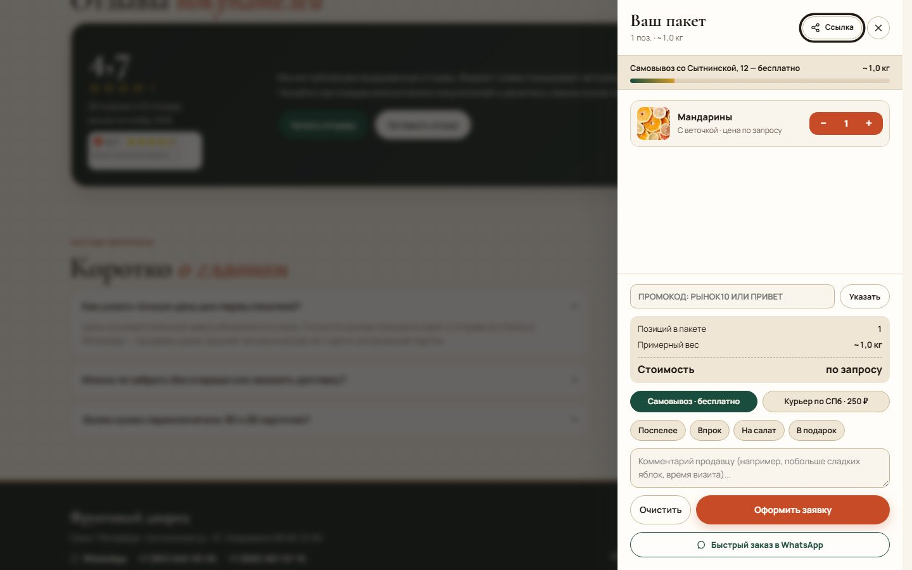 | 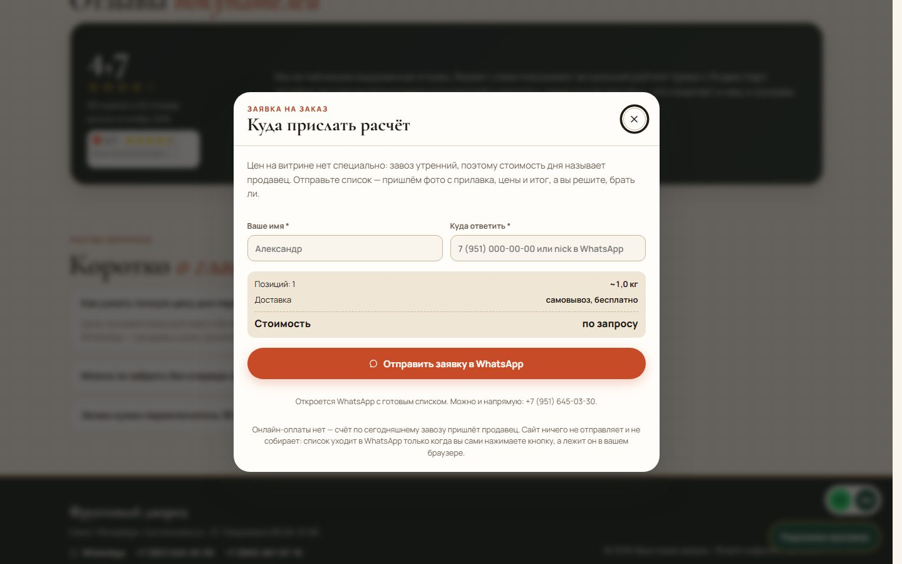 | 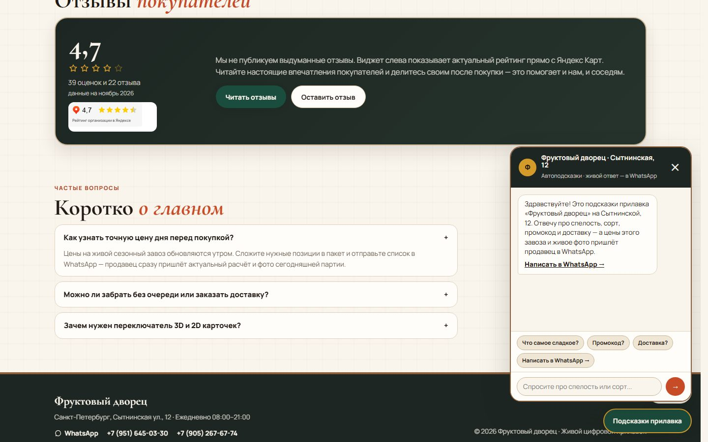 | 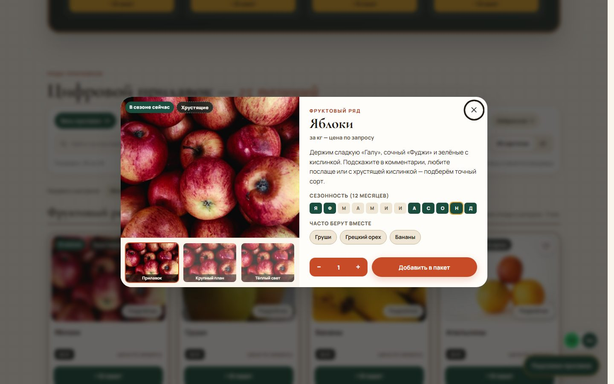 |

Пять палитр одного и того же кадра:

| Живой рынок | Светлая | Инжир и золото | Изумруд | Ночной базар |
|---|---|---|---|---|
| 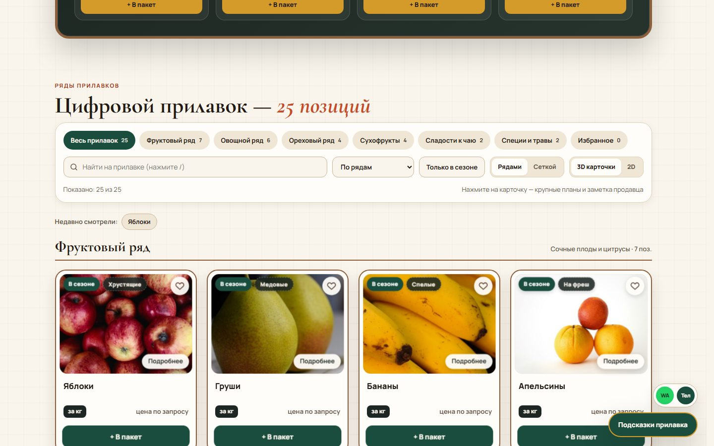 | 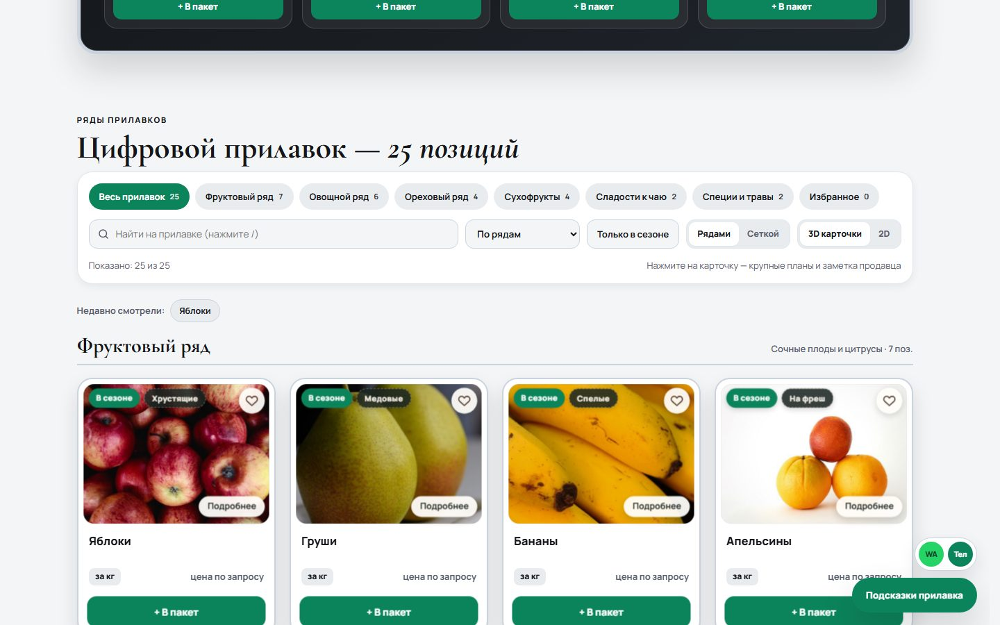 | 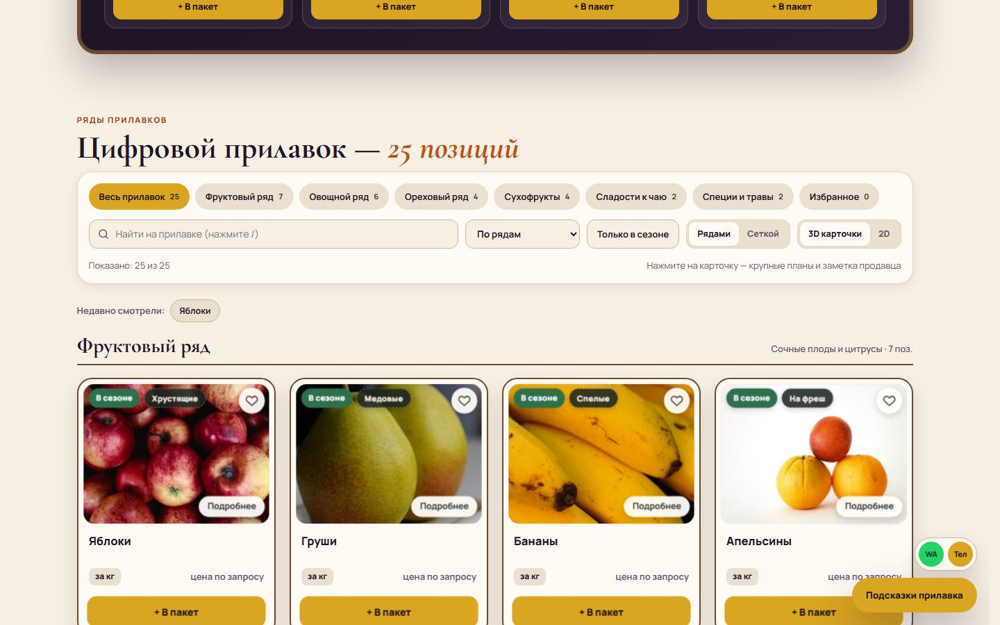 | 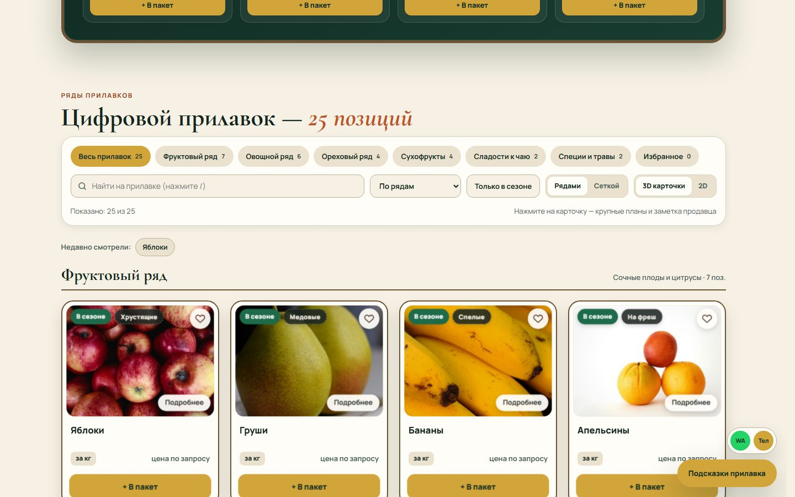 | 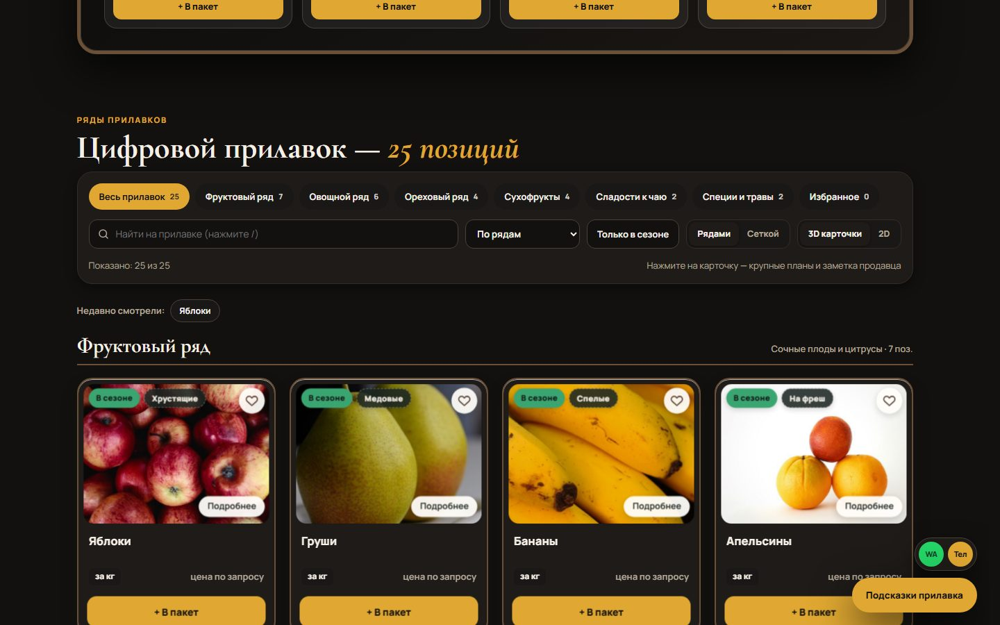 |

Телефон 390×844:

| Первый экран | Ряды | Пакет |
|---|---|---|
| 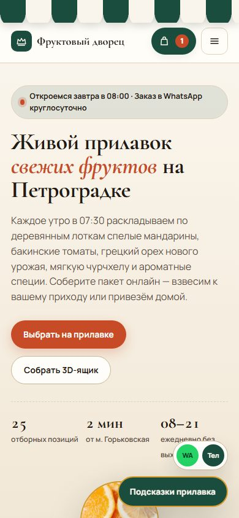 | 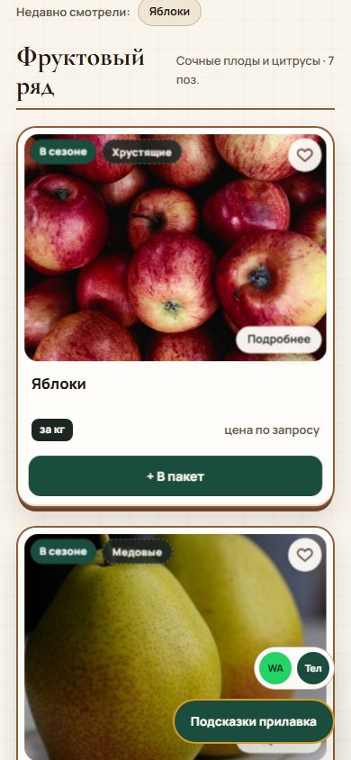 | 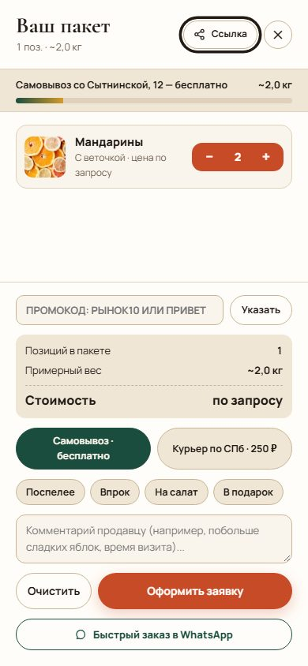 |

## Структура

```
index.html            страница: разметка + inline SVG-спрайт иконок + JSON-LD магазина
css/style.css         все пять палитр, компоненты и печать — одним файлом
js/app-head.js        тема до первой отрисовки: localStorage → data-theme на <html>
js/data.js            данные: магазин, позиции, промокоды, ключи localStorage
js/app.js             приложение: каталог, пакет, конструктор, сезоны, лайтбокс, чат
sw.js                 офлайн-кэш (версию проставляет сборка)
404.html              страница «не найдено» в тех же темах
manifest.webmanifest  PWA: иконки, цвет, start_url
tools/build.py        сборка: шрифты, фото, og, SEO-каталог, иконки PWA, минификация
tools/test_cart.py    юнит-тесты пакета в реальном JS-движке (quickjs)
tools/check.py        гейт качества: разметка, JSON-LD, ссылки, иконки, CSP, палитры, тап-цели
tools/gate_bite.py    доказательство, что каждый пункт гейта кусается (мутации файлов)
.github/workflows/deploy.yml  CI: secret scan → сборка → тесты → гейт → Pages
docs/screens/             скриншоты живого рендера (1440×900 и 390×844)
```

## Локальный запуск

```bash
python -m venv .venv && . .venv/Scripts/activate   # Windows: .venv\Scripts\activate
pip install pillow rcssmin rjsmin quickjs
python tools/build.py               # фото (Pexels) и шрифты (OFL) в assets/, css/js не трогает
python tools/test_cart.py
python tools/check.py
python -m http.server 8080   # и открыть http://localhost:8080
```

`build.py` идемпотентен, но минификацию делает НАД ИСХОДНИКАМИ: `python tools/build.py --minify`
(в CI это шаг `--minify-only`) перетирает `css/style.css`, `css/fonts.css` и все `js/*.js` их
jsmin-версией, а заодно обновляет версию кэша service worker и lastmod в sitemap. Обычный
`python tools/build.py` css/js не трогает — только качает ассеты и штампы. Локально поэтому
и запускают сборку без минификации: читаемые css/js нужны не только для глаз,
`tools/gate_bite.py` ищет правила мутаций по исходному тексту и на переминифицированном
дереве падает на собственном якоре. В CI это безопасно — там своя копия репозитория, гейты
прогоняются по читаемым исходникам, а боевой (минифицированный) вид CI собирает сам.
Сгенерированные ассеты (assets/img, шрифты, fonts.css, og, иконки PWA) в git не хранятся —
их собирает CI на каждом деплое. Если Pexels не отдал фото, сборка падает с `PHOTO FAIL`
и пишет плейсхолдеры только в рабочую копию: красная сборка перезапускается, а витрина
с градиентными плитками вместо фруктов висела бы до первого взгляда.

## Проверки перед push

```bash
python tools/check.py        # статика: 169 пунктов
python tools/gate_bite.py    # 189 мутаций: каждая обязана сломать сборку
```

`gate_bite.py` правит файлы в рабочей копии и восстанавливает их по снимку; exit 0 означает,
что ни один пункт гейта не протух. Статические проверки не заменяют осмотр пикселей:
contrast, кольцо фокуса, reduced-motion и печать сверяются скриншотами живого рендера —
эти замеры лежат вне репозитория и запускаются вручную перед каждым релизом.

## Деплой

1. Push в `main` → job `quality` (secret scan, сборка, тесты, гейт) → деплой на Pages.
2. Settings → Pages → Source: **GitHub Actions** (больше ничего настраивать не нужно).

Canonical-адрес: `https://ssrjkk.github.io/fruktovy/`. При подключении своего домена
заменить адрес в `index.html` (canonical, og:url), `robots.txt`, `sitemap.xml`.

## Темы оформления

Пять палитр одного и того же сайта: «Живой рынок» (по умолчанию), «Светлая витрина»,
«Инжир и золото», «Изумруд и пергамент», «Ночной базар». Переключатель — `.theme-swatches`
в первом экране и `.mobile-themes` в мобильном меню; разметка и данные общие, отличаются
только токены. Выбор хранится в localStorage под ключом `fd.theme` и применяется
`js/app-head.js` до первой отрисовки, поэтому вспышки чужой темы при загрузке нет.

- Все палитры живут в `css/style.css` блоками `html[data-theme="…"]`; база — `:root`,
  она же `market`. Отдельного файла тем больше нет.
- `tools/check.py` не даёт палитре завести токен, которого нет в базе, и наоборот:
  каждый токен обязан быть переопределен во всех пяти, иначе сборка красная.
- Чтобы убрать тему, достаточно вычеркнуть её блок в css и кнопку в `index.html` —
  база останется рабочей; правок в js не требуется.

## Данные и цены

Цен на сайте нет намеренно: `price` и `oldPrice` в `js/data.js` всегда `null`, карточка
показывает «цена по запросу», а итог пакета продавец называет в WhatsApp. Чтобы включить
цены, проставить `price` в данных — корзина, конструктор и SEO подхватят сами, но тогда
нужен и способ оплаты: сейчас его нет, и кнопка «оформить» открывает заявку, а не чек.

Позиция в `PRODUCTS` — это и есть витрина: `name`, `unit`, `photo` (id снимка Pexels или свой
файл в `assets/img`), `season` (месяцы), `use` (что из этого на кухне) и `store` (как хранить
его дома). Правка `js/data.js` не требует сборки: push в `main`, CI соберёт и выложит на Pages.
`tools/check.py` не даст оставить позицию без описания, без заметки о хранении и без решения,
когда грузить её фото.

## Печать и движение

- `@media print` оставляет на листе список, ряды, сезоны, реквизиты и ответы частых вопросов;
  кнопки, фильтры, поиск, маркизу, чат и плавающий док связи прячет, всё дерево красится
  чёрным по белому. Гейт следит, чтобы в этом списке не было селекторов в никуда:
  мёртвый селектор вернул бы на бумагу кнопку, которую все считали убранной.
- `prefers-reduced-motion: reduce` останавливает бегущую строку, отключает плавный перелёт
  по якорям и не даёт включить 3D-наклон карточек: `js/app-head.js` при этом флаге ставит
  `data-cards="2d"` до первой отрисовки.

## Что нужно от магазина, чтобы сайт работал сам

- Свои снимки прилавка вместо стоковых: сейчас группы товаров делят одни и те же фото.
- Часы работы и оба телефона: они живут в `SHOP`, а `openingHours`, `telephone` и
  `alternateTelephone` в JSON-LD гейт сверяет с `data.js` — разъезд ломает сборку.
- Домен: при подключении достаточно заменить адрес в `index.html` (canonical, og:url),
  `robots.txt` и `sitemap.xml`.
- Цены — если решат их показывать: тогда пакет и конструктор начнут считать итог сами.

## Лицензии ассетов

Фото — Pexels License; шрифты Manrope, Cormorant Garamond и Oswald — SIL OFL 1.1
(качаются сборкой из @fontsource); иконки — inline SVG в `index.html`, рисуются здесь же.
Сторонних JS-библиотек в витрине нет: наклон карточек, лайтбокс, пакет и переключение палитр
написаны руками.
Полный список — `assets/CREDITS.txt` после сборки.

---

## English (brief)

Single-page storefront for a fruit and vegetable shop in Saint Petersburg: 25 catalog
positions, search, aisle/grid views, an order basket, crate builder, seasonal calendar and
gallery. No prices and no payments are shown — the seller names the day's price in WhatsApp,
and checkout opens a messenger request.
Vanilla HTML/CSS/JS, all assets self-hosted, zero trackers, no third-party JS libraries.
Five palettes share one markup and one stylesheet: each is a `html[data-theme="…"]` token
block, the choice is stored in `localStorage` (`fd.theme`) and applied before first paint by
`js/app-head.js`. CI (`quality` job) runs a secret scan, builds assets (Pexels photos, OFL
fonts), executes basket unit tests in a real JS engine and a 169-point quality gate, then
deploys to GitHub Pages. Run locally: `pip install pillow rcssmin rjsmin quickjs`, then
`python tools/build.py && python tools/test_cart.py && python tools/check.py`
(plain `build.py` leaves css/js readable; the minifying step is `--minify` and belongs to CI,
see «Локальный запуск»).
