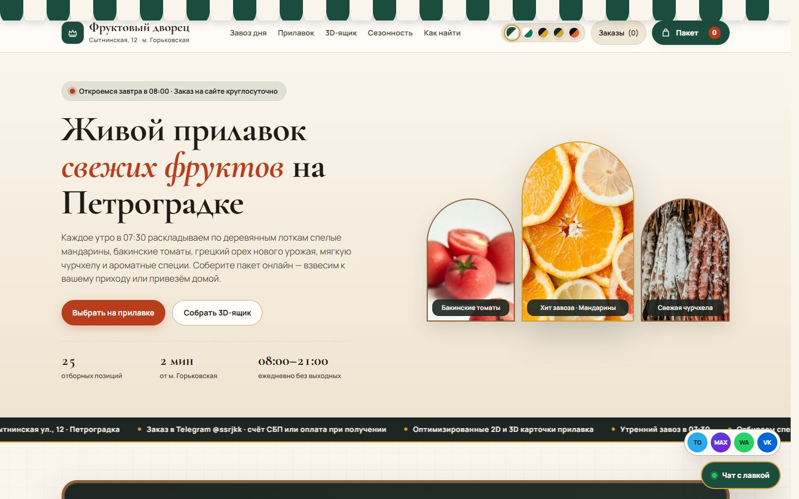
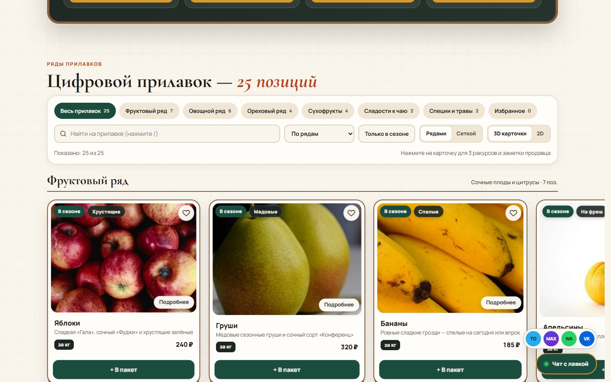
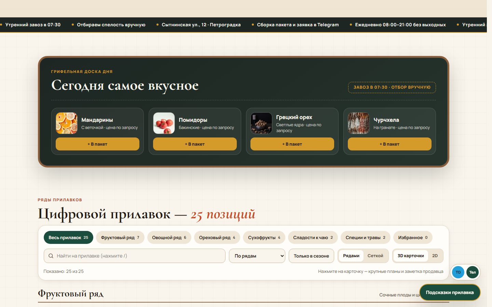
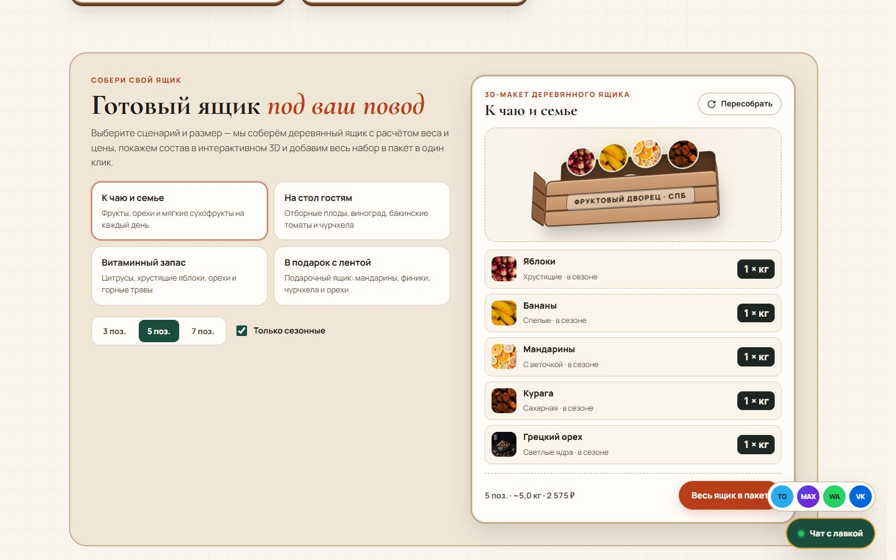
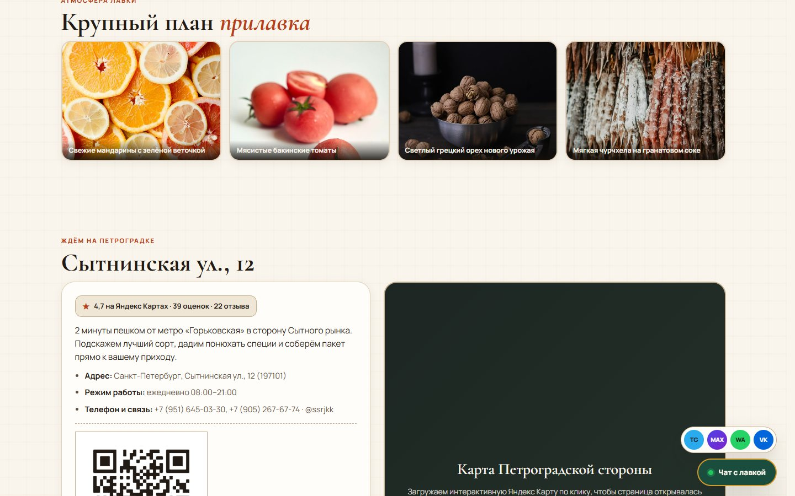
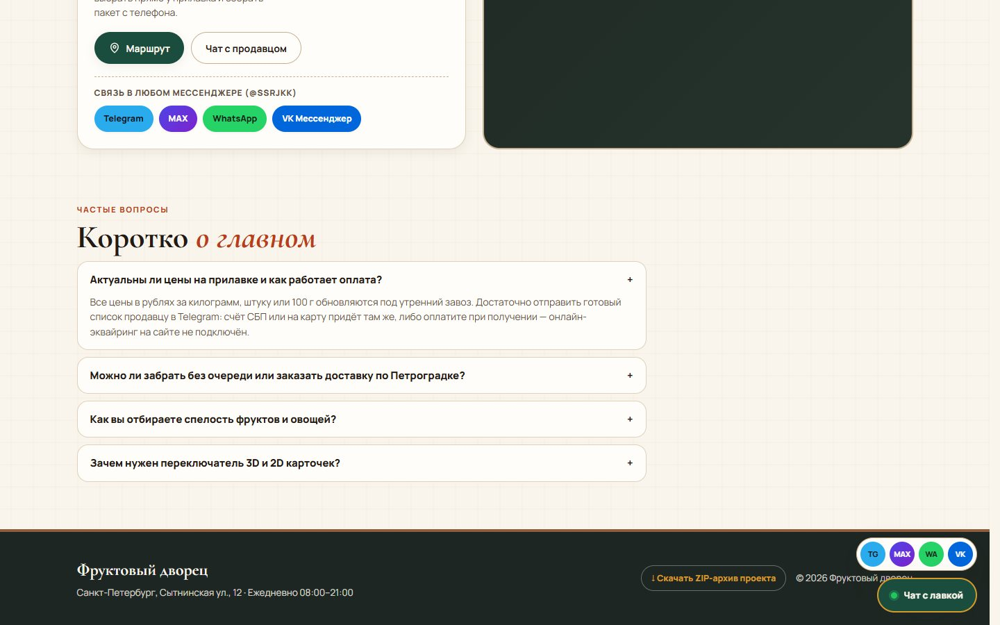
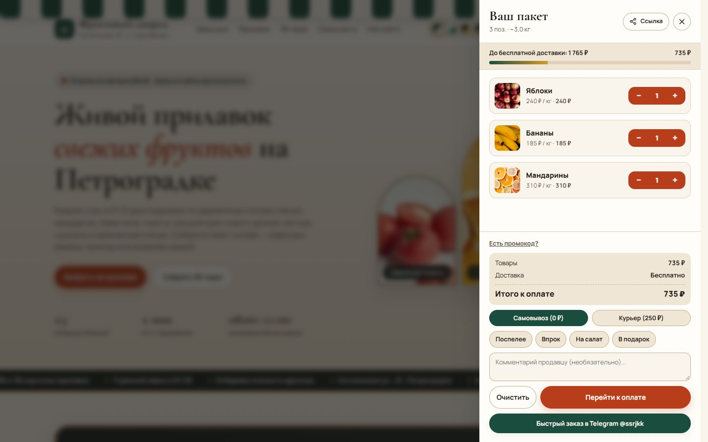
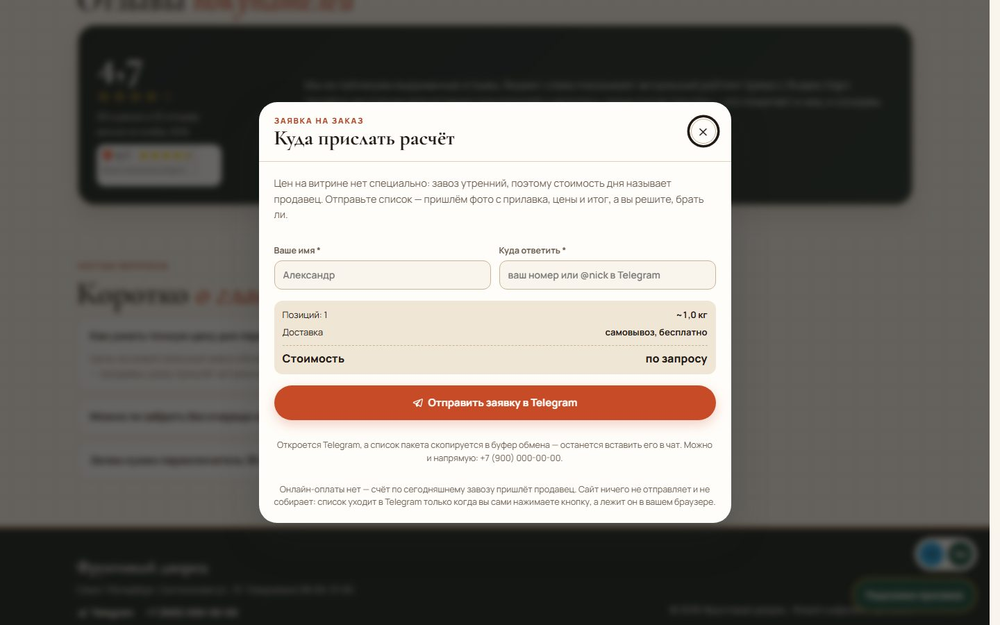
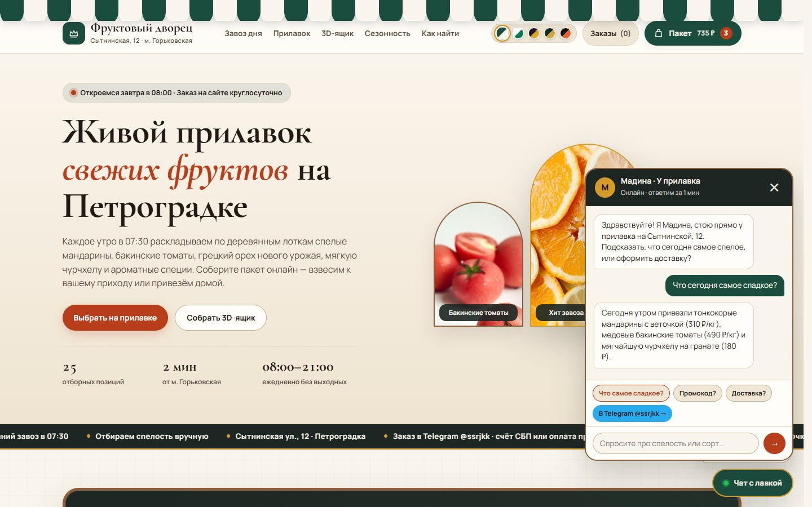
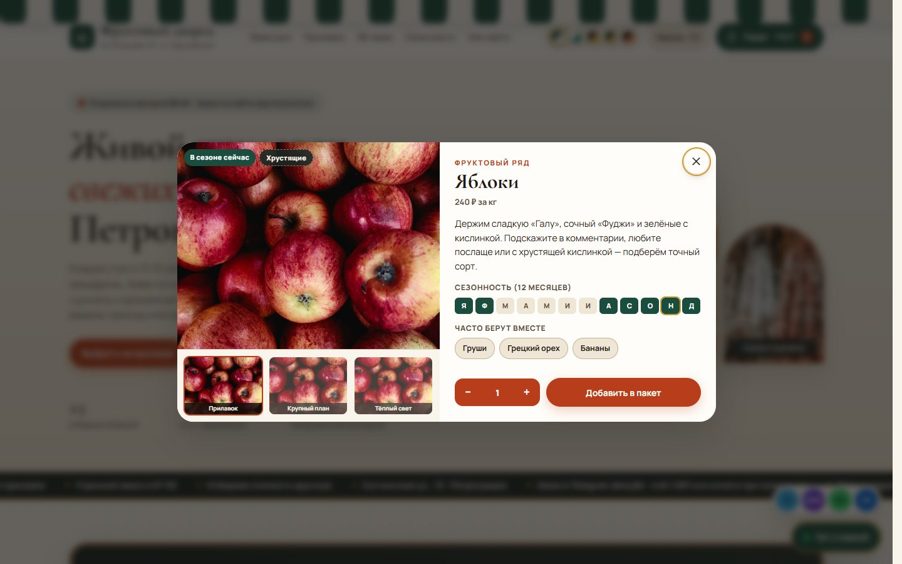

# Фруктовый дворец — витрина с заявкой в Telegram

> **Языки:** [English](README.md) · [Русский](README.ru.md)

Одностраничный сайт лавки «Фруктовый дворец» (Санкт-Петербург, Сытнинская ул., 12):
каталог из 25 позиций с поиском, рядами и сеткой, пакет с повтором заказа, конструктор
ящика, сезонный календарь, галерея с лайтбоксом, пять тем оформления, 2D и 3D-карточки,
чат с продавцом и выгрузка всего проекта в ZIP прямо из браузера.

Оплата на сайте не принимается: чекаут формирует заявку, счёт СБП или на карту приходит
продавцу в Telegram, либо покупатель платит при получении. Онлайн-эквайринг не подключён.

Витрина собирается без сборки: один `index.html` со своими стилями и скриптами, фото,
шрифты, иконки и превью лежат в репозитории. При открытии страница не обращается к чужим
доменам — ни CDN, ни шрифтов Google, ни пикселей аналитики; границы заданы CSP-заголовком
в `<head>`. Одно исключение видно самому покупателю: интерактивная Яндекс Карта грузится
только после нажатия «Показать на карте», до клика запрос идёт лишь на свой домен.

## Витрина на скриншотах

Снимки — живые рендеры этой же сборки, снятые headless Chrome в 1440x900 и 390x844:
это экраны страницы, а не макеты и не генерация изображений.

| Первый экран | Ряды прилавка | Грифельная доска |
|---|---|---|
|  |  |  |

| Конструктор ящика | Галерея | Вопросы |
|---|---|---|
|  |  |  |

| Пакет | Заявка | Чат | Быстрый просмотр |
|---|---|---|---|
|  |  |  |  |

Дальше: [визит и карта](docs/screens/11-visit.jpg), [просмотр фото на весь экран](docs/screens/12-lightbox.jpg),
[сезонная таблица](docs/screens/13-seasons.jpg).

Мобильная версия (390x844): [первый экран](docs/screens/20-mobile-hero.jpg),
[ряды](docs/screens/21-mobile-aisle.jpg), [пакет](docs/screens/22-mobile-basket.jpg),
[просмотр товара](docs/screens/23-mobile-peek.jpg).

Палитры целиком: [market](docs/screens/14-palette-market.jpg),
[light](docs/screens/14-palette-light.jpg), [fig](docs/screens/14-palette-fig.jpg),
[emerald](docs/screens/14-palette-emerald.jpg), [night](docs/screens/14-palette-night.jpg).

## Структура

```
index.html              витрина: разметка, стили, скрипты, данные 25 позиций
404.html                заглушка Pages, самодостаточная, со своим CSP
assets/img/*.jpg        25 кадров x 7 размеров, кадрирование заранее готово
assets/fonts/*.woff2    Cormorant Garamond и Manrope, подмножества latin и cyrillic
assets/fonts.css        подключение шрифтов с font-display: swap
assets/logo.svg         фавикон и иконка манифеста
assets/qr.svg           QR на эту страницу, блок «Как найти»
assets/og.png           превью ссылки 1200x630
assets/icon-192.png     иконки для домашнего экрана и манифеста
assets/icon-512.png
assets/CREDITS.txt      лицензии фото и шрифтов, происхождение файлов
robots.txt              правила индексации
sitemap.xml             карта сайта
manifest.webmanifest    PWA-манифест
scripts/gate.mjs        статический гейт: цифры, ссылки, контраст, синхронизации
make_zip.py             сборка fruktovy-dvorets-release.zip из командной строки
AGENT_DEPLOY.md         как выложить это в репозиторий и на хостинг
NEXT_AGENT_PROMPT.md    системный промпт для того, кто продолжит работу
.github/workflows/      deploy.yml (Pages) и codeql.yml
```

## Открыть витрину на телефоне

1. Включите на телефоне и на компьютере одну и ту же сеть Wi-Fi.
2. Узнайте локальный адрес машины и запустите сервер на всех интерфейсах:

   ```bash
   python -m http.server 8080 --bind 0.0.0.0
   ```

3. На телефоне откройте `http://<адрес-компьютера>:8080/`.
4. Быстрее всего — навести камеру на QR в блоке «Как найти» (`assets/qr.svg`): он ведёт
   на опубликованный адрес.

## Локальный запуск

```bash
python -m http.server 8080     # открыть http://127.0.0.1:8080/
```

`file://` тоже открывается, но тогда кнопка выгрузки ZIP и повторный запрос файлов не
работают: архив собирается запросами к серверу, а не из текста страницы.

## Проверки перед push

```bash
node scripts/gate.mjs                     # статика: ссылки, каталог, контраст, FAQ 1:1, CSP
node -e "const fs=require('fs');const s=fs.readFileSync('index.html','utf8');
  [...s.matchAll(/<script(?![^>]*ld\\+json)[^>]*>([\\s\\S]*?)<\\/script>/g)]
  .forEach((m,i)=>fs.writeFileSync('_s'+i+'.js',m[1]));" && node --check _s0.js && node --check _s1.js
python make_zip.py                        # архив собирается, все 10 файлов целы
```

Гейт проверяет числами: у 25 позиций описания и уникальные кадры, месяцы сезона идут по
возрастанию, каждый генерируемый путь `assets/img/<id>-<w>x<h>.jpg` лежит в репозитории,
контраст посчитан из хексов токенов по пяти палитрам и 14 парам (порог 4.5:1, худшая пара —
5.32:1), вопросы видимого FAQ совпадают с JSON-LD знак в знак, в интерфейсе нет пиктограмм,
у всех `img` заданы `width`/`height` и `alt`, страница не ходит на чужие домены.

Статика не заменяет осмотр пикселей: фокус, reduced-motion, печать, контраст из живого DOM,
Zero-CLS и реальная раскладка на 320, 360, 390, 414 и 1440px сверяются живым браузером перед
каждым релизом (шаги в `AGENT_DEPLOY.md`).

## Деплой

1. Push в `main` → job `quality` (secret scan, `node --check`, `scripts/gate.mjs`) → job `deploy` → Pages.
2. Settings → Pages → Source: **GitHub Actions**.

Canonical-адрес: `https://ssrjkk.github.io/fruktovy/`. При подключении своего домена
заменить адрес нужно в `index.html` (canonical, og:url, JSON-LD `@id` и `url`), `robots.txt`
и `sitemap.xml` — гейт проверит, что все три сошлись на одном origin.

## Темы оформления

Пять палитр одного и того же сайта: «Живой рынок» (по умолчанию), «Светлая витрина»,
«Инжир и золото», «Изумруд и пергамент», «Ночной базар». Переключатель — свотчи в первом
экране и в мобильном меню; разметка и данные общие, отличаются только токены. Выбор
хранится в localStorage под ключом `fd.theme` и применяется маленьким инлайновым скриптом
до первой отрисовки, поэтому вспышки чужой темы при загрузке нет.

- Все палитры живут в `index.html` блоками `html[data-theme="…"]`; база — `:root`, она же `market`.
- Гейт требует, чтобы каждый проверяемый токен был переопределен во всех пяти палитрах:
  если в одной теме токен пропущен, сравнение контраста не состоится и сборка красная.
- Чтобы убрать тему, достаточно вычеркнуть её блок и кнопку — база останется рабочей.

Рядом с темами живёт переключатель `3D карточки` / `2D` (`fd.cardMode`): на тач-экранах
и при `prefers-reduced-motion: reduce` витрина сама становится в 2D.

## Данные и цены

Каталог — массив `PRODUCTS` в `index.html`, 25 позиций. Поля: `id`, `name`, `desc` (одна
строка про вкус и происхождение), `cat`, `unit`, `weightKg`, `price`, `oldPrice`, `photo`
(идентификатор кадра), `color`, `season` (месяцы по возрастанию), `tag`, `together`, `note`.

Добавить позицию — это три правки в одном месте: строка в `PRODUCTS`, ссылка в ряд
(`rows`) и кадр в `assets/img/` во всех размерах, которые запросит код:

```bash
# размеры, которые витрина просит для каждого id
node -e "const s=require('fs').readFileSync('index.html','utf8');
  const set=new Set([...s.matchAll(/photoSrc\([^,]+,\s*(\d+),\s*(\d+)\)/g)].map(m=>m[1]+'x'+m[2]));
  console.log([...set].sort().join(' '))"
```

Цены пересчитываются вручную под утренний завоз: витрина не хранит прайс на сервере,
`₽` берутся прямо из массива. Промокоды (`РЫНОК10`, `ПРИВЕТ`) и порог бесплатной доставки
(2 500 ₽) — константы в том же файле.

## Печать и движение

Печатная версия (`@media print`) оставляет на листе состав пакета, сумму и контакты,
срезая декор, карточки прилавка и плавающие кнопки — чек можно распечатать из браузера.
Анимации наклона и поворота ящика идут только через `transform` и `opacity` внутри
`requestAnimationFrame`, `will-change` снимается в покое, `content-visibility: auto`
подключён для длинных секций, `scrollbar-gutter: stable` убирает сдвиг макета при открытии
диалогов.

## Выгрузка проекта из браузера

Кнопка `Скачать ZIP-архив проекта` в подвале запрашивает десять файлов релиза у того же
сервера и пакует их в `fruktovy-dvorets-release.zip` (STORE, собственный CRC-32, без
библиотек). То же самое делает `python make_zip.py`, а `--with-assets` добавляет фото и
шрифты — полный офлайн-комплект. Каждый файл архива лежит в репозитории в том же виде,
поэтому расхождение между скачанным и задеплоенным невозможно.

## Что нужно от магазина, чтобы сайт работал сам

- Прайс-лист в понятном виде (позиция, цена, единица, сезон) — сейчас цифры вносятся руками.
- Ответственный за Telegram-аккаунт @ssrjkk: заявка уходит туда, там же продавец называет
  итог и присылает счёт.
- Если понадобится настоящая оплата — подключается эквайринг или СБП-счёт, и чекаут
  переписывается на серверный вызов; визуально и по геометрии карточек это не меняется.
- Фото витрины лучше свои: сейчас это стоковые кадры Pexels, лежащие в репозитории, —
  снимки самой лавки были бы честнее и узнаваемее.

## Лицензии ассетов

Фото — Pexels License (без обязательной атрибуции), шрифты — SIL Open Font License 1.1.
Список идентификаторов кадров, размеров и происхождения файлов лежит в `assets/CREDITS.txt`.
Все ассеты скопированы в репозиторий, страница ничего не подгружает извне.

## Документация

- [Deploy](AGENT_DEPLOY.md)
